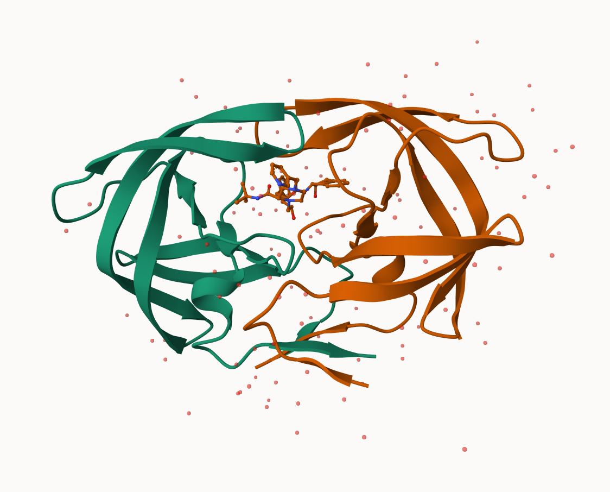
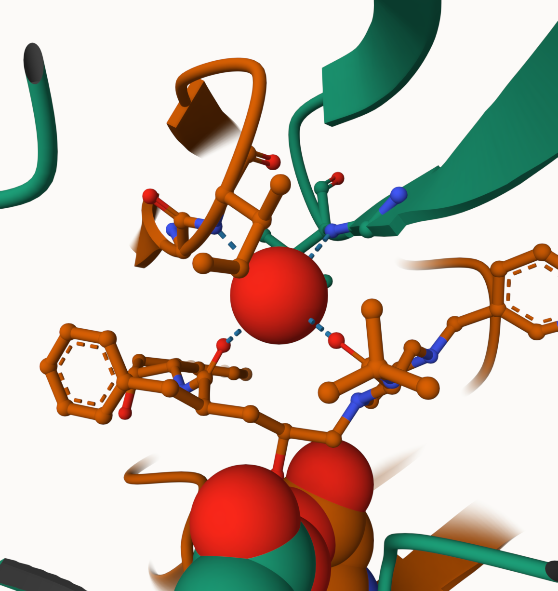
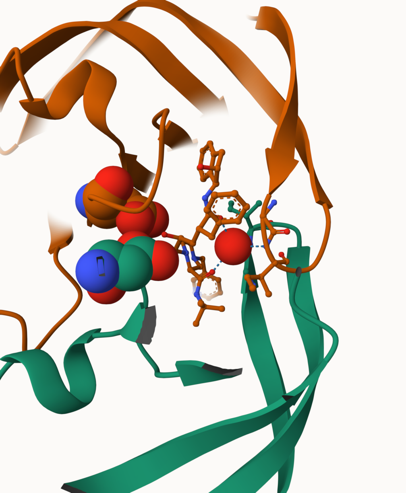
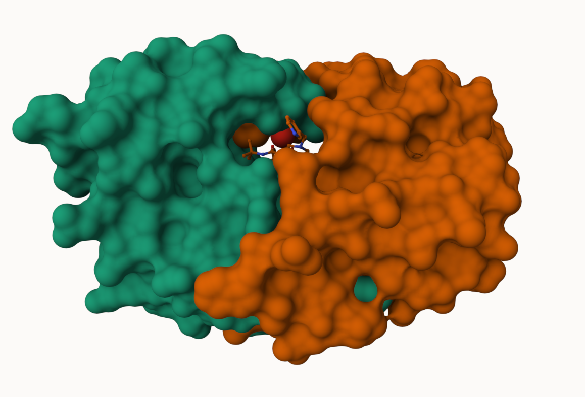
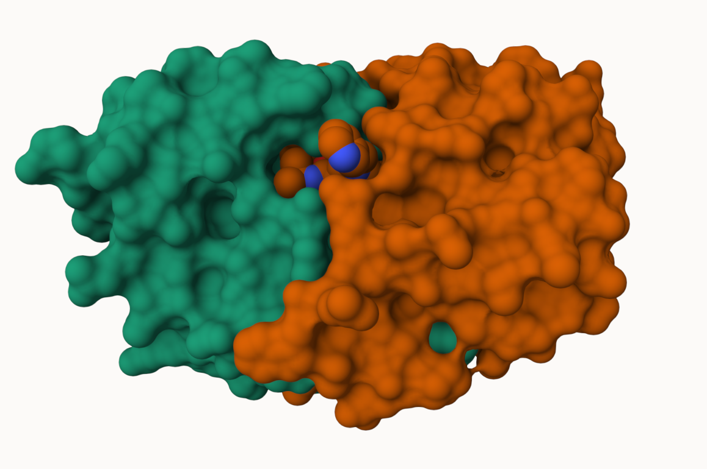
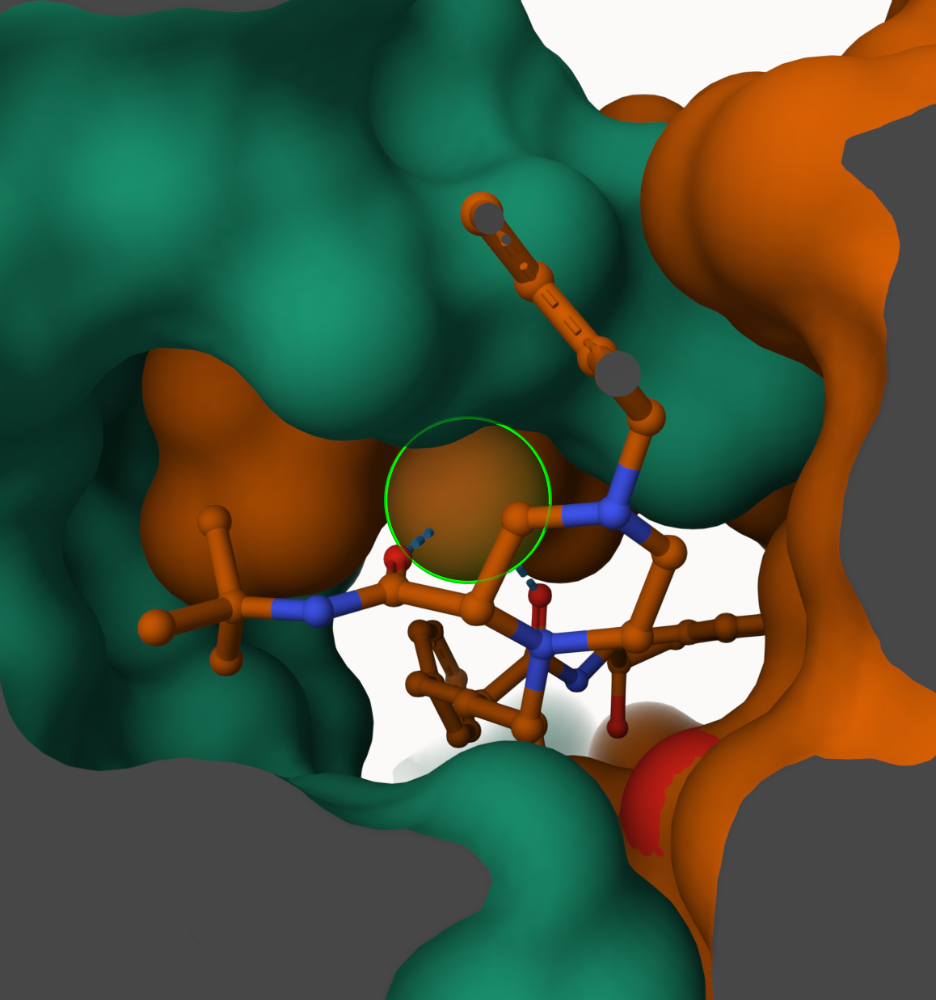
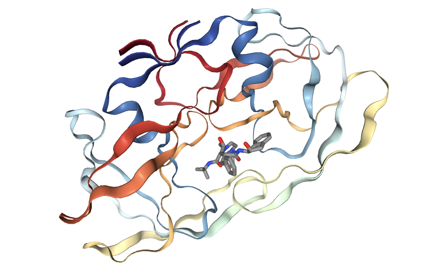
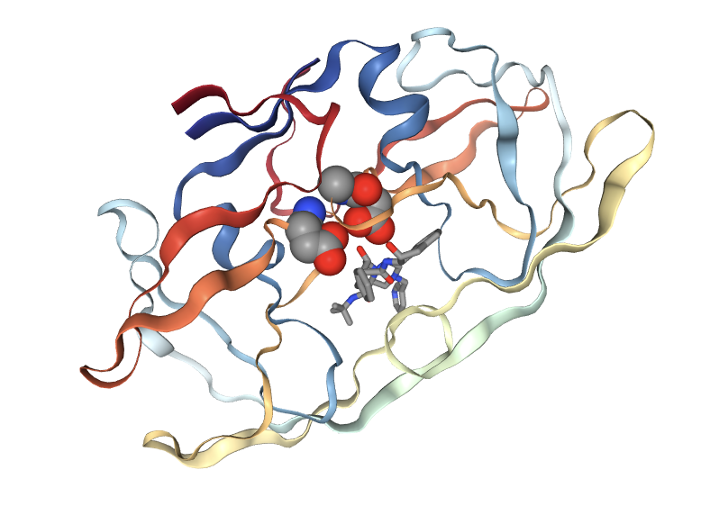
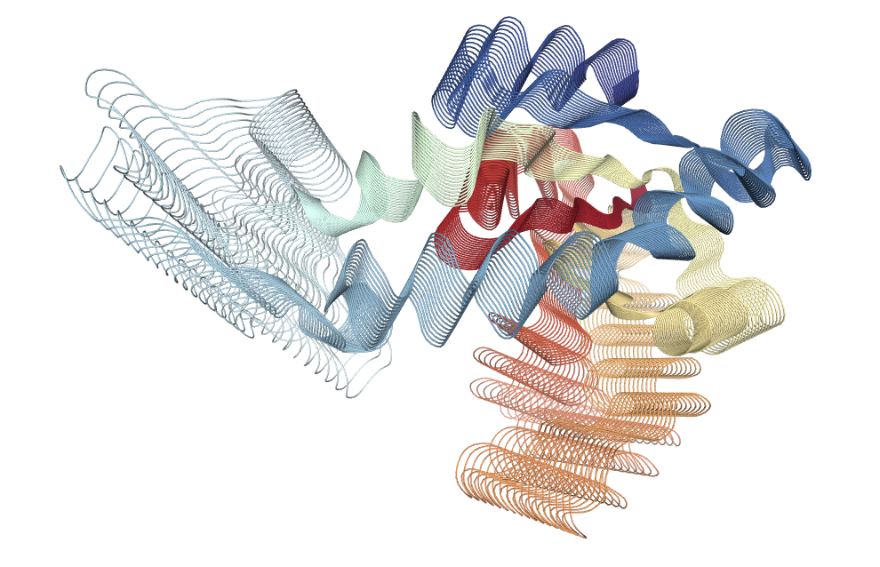
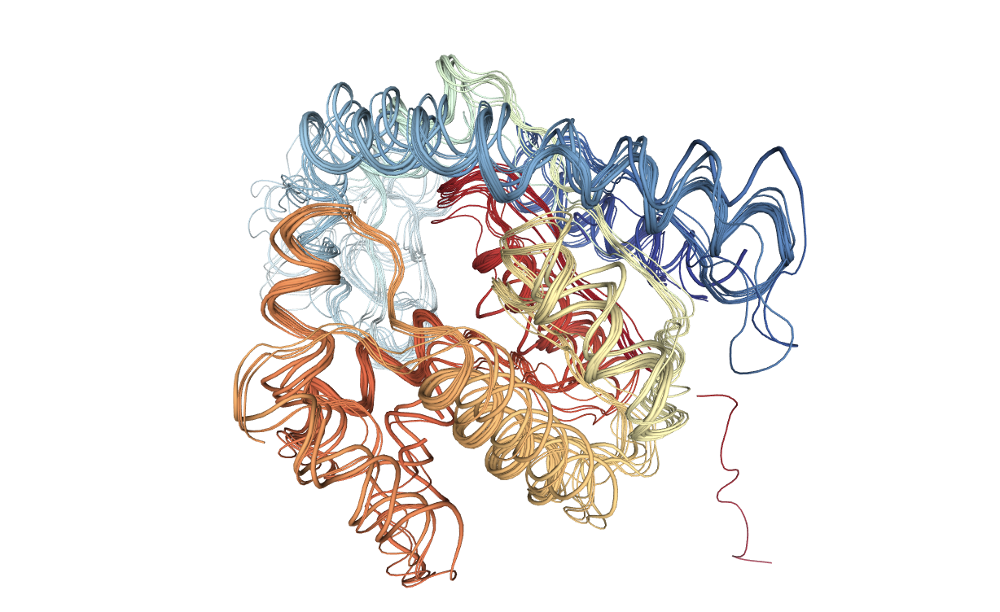

## Background

### Structural Bioinformatics

Goals: 

- Characterize and interpret biological molecules and their assemblies with a high level of detail
- Bridge between sequence -> structure -> function

Genomics is a great start, but a parts list is not enough to understand how something works. We want the full spatiotemporal picture, and an ability to control it. 

What can we do with structure?

- Structure is encoded in sequence, so understanding the determinants of structure allows manipulation & design of proteins.
- Structure determines function, so it can allow us to characterize protein function. 
- Structure is more conserved than sequence, so it can allow identification of more distant evolutionary relationships.

Structural bioinformatics has broad applications, including drug design, medical diagnostics, chemical manufacturing, etc.

> Key concept: energy landscape

### Exploring Structural Representations with C-ABL Kinase

> Note: CA = central carbon/alpha carbon

In reality, water is tightly packed around the protein and closely interacts with it. If we take out the water, we can see the actual protein. 

Proteins are closely packed but flexible objects (globular). Due to their large size and complexity it is often hard to see what's important in the structure. Backbone or main-chain representation can help trace chain topology and reveal secondary structure. This narrows down the protein to the core <1% or so of the atoms that can tell us the most about the protein.

Tube or trace representation is one of the simplest views. It only leaves one atom per amino acid visible, just tracing the general path of the structure. Adding colors can highlight secondary structures, and "cartoon" representations can tell us more about them. Viewing in 3D is often essential for interpretation.

> Note: conventionally, the N-terminus (start) is in blue, and the C-terminus (end) is in red.

In the end, we get a representation that's pretty far from reality, but much more useful to us. 

Viewing multiple superposed structures solved under different conditions can highlight flexible regions. That is, we can see which parts of the protein are more dynamic and in what way.

Analyzing these multiple structures can reveal functional motions -- i.e., displacements that are essential for regulating function.

Normal Mode Analysis (NMA) models the protein as a network of elastic strings. NMA is a bioinformatics method to predict the intrinsic dynamics of biomolecules.

## PDB 

The [PDB database](https://www.rcsb.org) is the main repository of biomolecular data:

We can "scrape" the PDB statistics data from https://www.rcsb.org/statistics/summary with the **datapasta** package.

```{r, echo=FALSE}
pdb <- data.frame(
  stringsAsFactors = FALSE,
       check.names = FALSE,
           Molecular.Type = c("Protein (only)",
                              "Protein/Oligosaccharide","Protein/NA",
                              "Nucleic acid (only)","Other","Oligosaccharide (only)",
                              "Total"),
         Xray = c(184948, 10729, 9345, 3222, 178, 11, 208433),
                EM = c(25926, 4048, 7539, 347, 27, 1, 37888),
               NMR = c(12907, 34, 288, 1599, 35, 6, 14869),
       Integrative = c(365L, 8L, 27L, 3L, 4L, 0L, 407L),
  Multiple.methods = c(232L, 11L, 8L, 15L, 0L, 1L, 267L),
           Neutron = c(86L, 1L, 0L, 3L, 0L, 0L, 90L),
             Other = c(32L, 0L, 0L, 1L, 0L, 4L, 37L),
             Total = c(224496, 14831, 17207, 5190, 244, 23, 261991)
       )
```

```{r}
pdb
```


> Q1: What percentage of structures in the PDB are solved by X-Ray and Electron Microscopy.

```{r}
total.ind <- pdb$Molecular.Type == "Total"
n.xray <- pdb$Xray[total.ind]
n.em <- pdb$EM[total.ind]
n.total <- pdb$Total[total.ind]
percent.both <- ((n.xray + n.em)/n.total)*100
percent.xray <-(n.xray/n.total)*100
percent.em <-(n.em/n.total)*100
round(percent.xray, 2)
round(percent.em, 2)
round(percent.both, 2)
```

> Q2: What proportion of structures in the PDB are protein?

```{r}
prot.ind <- pdb$Molecular.Type == "Protein (only)"
n.protein <- pdb$Total[prot.ind]
percent.prot <- (n.protein/n.total)*100
round(percent.prot, 2)
```

>Q2.5: What is the total number of protain structures in the database? What percent of known protein sequences have a known protein structure?

Total number in the protein sequence database (from UniProt): 149430635

```{r}
n.protein
round((n.protein/149430635)*100, 2)
```
We only know the structure of **0.15%** of known protein sequences.

> Q3: Type HIV in the PDB website search box on the home page and determine how many HIV-1 protease structures are in the current PDB?

N/A


## Visualizing Structure With Mol*

We are going to look at the structure of HIV-1 Protease. This protein is a drug that helps keep viral load low in HIV patients. It is a protease, meaning that it cleaves proteins. This one uses aspartic acid residues to cut.

We are going to learn how to use the [Mol* Viewer](https://molstar.org/viewer/). Let's read in the protein to Mol* with its accession code, 1HSG.

The button that looks like a camera shutter lets us download an image from the viewer. We can then insert this image into our quarto document:



The text in the brackets is the figure caption, and the text in the parenthesis is the image file name. 

The little red dots floating around the protein are water molecules. You can turn them off(/on) with the eye icon next to "Water" on the right hand side of the screen.

You can click on a specific part of the structure to zoom in and reveal much more detail. You can also create components (using the button that looks like a cube) that highlight certain elements.











## Reading Structural Data in R

We can use the **bio3d** package to work with structural data in R.

```{r}
library(bio3d)

hiv <- read.pdb("1hsg")
hiv
```

```{r}
head(hiv$atom)
```

```{r}
head(pdbseq(hiv))
#gives the amino acid sequence
```

We can use the Bio3D partner package, **bio3dview**, to generate quick interactive molecular visualizations.

```{r, eval = FALSE}
library(bio3dview)
view.pdb(hiv)
```



Then, we can do the equivalent of what we did in Mol* with code instead, and highlight certain parts of the structure:
```{r, eval = FALSE}
asp <- atom.select(hiv, resno = 25)
view.pdb(hiv,
         highlight = asp,
         highlight.style = "spacefill")
```



## Predicting Protein Dynamics

Let's predict the internal dynamics and flexibility of Adenylate Kinase (ADK):
```{r}
adk <- read.pdb("6s36")
```

```{r}
m <- nma(adk)
plot(m)
```

```{r, eval = FALSE}
view.nma(m)
```



We can also make a pdb file that we can open in Mol*:
```{r}
mktrj(m, file = "adk_dynamics.pdb")
```

Then, after loading that file into Mol*, we can view an animation of the predicted dynamics/motion. 

> Note: We are leaving the PCA part of the lab for next class. For today, only answer questions 1-9. 

# Class 10: Structural Bioinformatics Pt. 2

## Background & Set-Up

New functions:

- `get.seq()`: retrieves a sequence; input = database identifier
- `blast.pdb()` & `get.pdb()`: PDB search & homologous structure set; find and download all related structures
- `pdbaln()`: align and superpose all structures
- `pca()`: PCA function that returns score plot (conformer plot) & loadings (dispacement trajectory)

Today we will perform PCA of protein structural data from PDB.

Load up the packages we will use:
```{r, message = FALSE}
# install.packages("BiocManager")
# BiocManager::install("msa")
library(bio3d)
library(ggplot2)
library(msa)
library(bio3dview)
```


## Analysis

We will start with a single sequence ID/accession number. 
```{r}
id <- "1ake_A"
```

Retrieve the sequence:
```{r}
aa <- get.seq(id)
```

> Side note: to do a BLAST or HMMER search, use: `b <- blast.pdb(aa)`. You could then plot a summary of the search results with `hits <- plot(b)`.

```{r}
hits <- NULL
hits$pdb.id <- c('1AKE_A','6S36_A','6RZE_A','3HPR_A','1E4V_A','5EJE_A','1E4Y_A','3X2S_A','6HAP_A','6HAM_A','4K46_A','3GMT_A','4PZL_A')
```

Download related PDB files:
```{r, message = FALSE}
files <- get.pdb(hits$pdb.id, path="pdbs", split=TRUE, gzip=TRUE)
```

Align & superpose structures:
```{r, message = FALSE}
pdbs <- pdbaln(files, fit = T, exefile = "msa")
```

View the superposed structures:
```{r, eval = FALSE}
view.pdbs(pdbs, colorScheme = "residueIndex")
```




